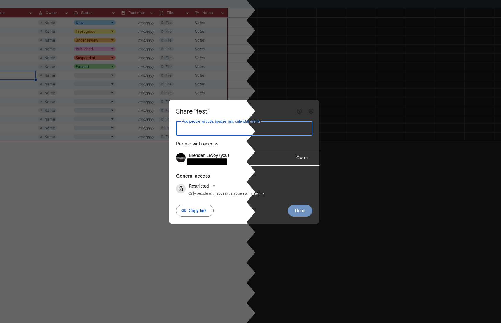

# DocsInDark

<b>DocsAfterDark, the project this project builds on: </b> https://github.com/waymondrang/docsafterdark/

DocsAfterDark is an extension which overrides the styles present in Google Docs and Google Sheets to achieve a dark theme.
 Since, ya know, google with its hundreds of billions of dollars can't do it themselves.
 Expect bugs, because it's really hard to style a page if you aren't the author of it.

If you encounter bugs, please report it in issues.

If you want to make a PR, feel free. Using LLMs for PRs is generally discouraged, but if you are an accomplished programmer (I will check your github account) then it's fine.

stay creative, godspeed :heart:
